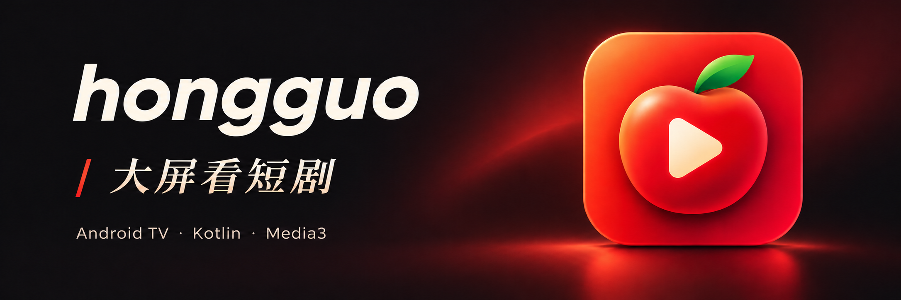
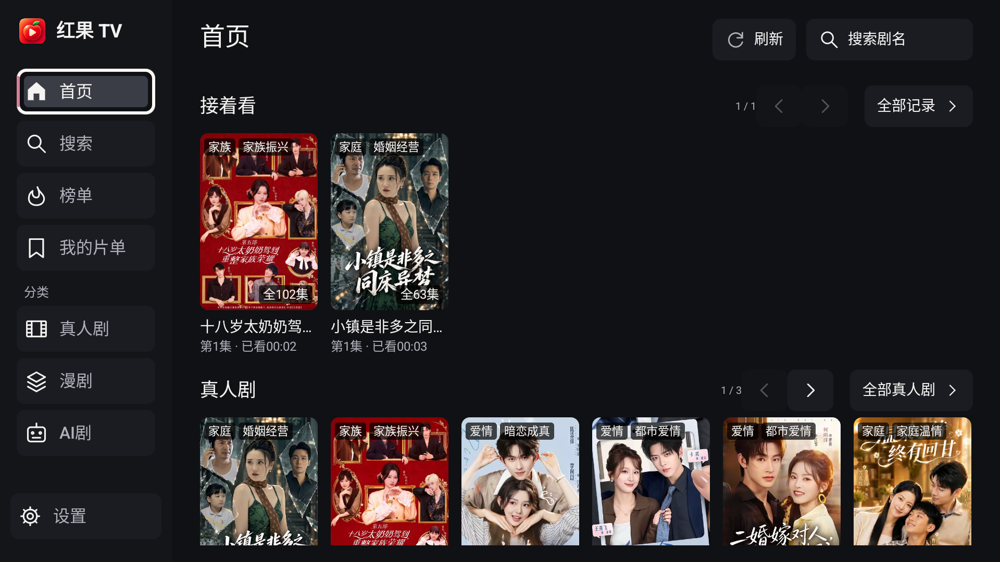
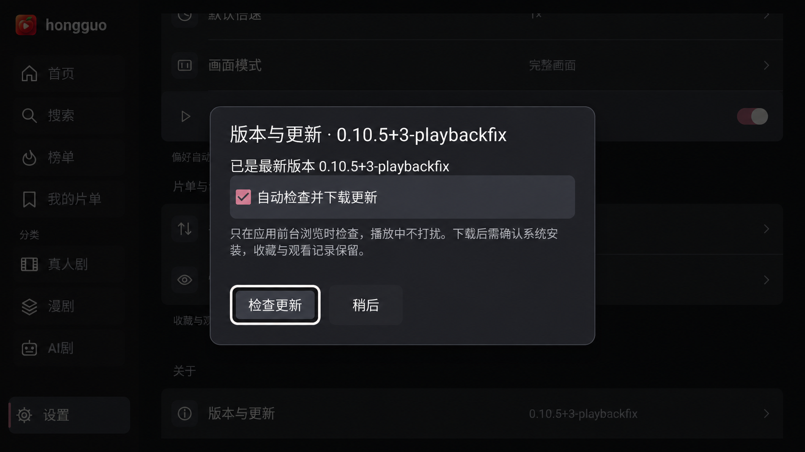

# 红果 TV



**简体中文** · [安装与使用](docs/INSTALL.zh-CN.md) · [兼容性](docs/COMPATIBILITY.zh-CN.md) · [Bug 反馈](https://github.com/BeatsAD/hongguoTV/issues/new?template=bug_report.yml) · [功能建议](https://github.com/BeatsAD/hongguoTV/issues/new?template=feature_request.yml)

面向 Android 电视和电视盒子的非官方短剧、漫剧客户端，支持遥控器浏览、搜索、选集和连续播放。

当前应用采用 **Kotlin + Android 原生 View + Media3**，最低支持 **Android 8.0（API 26）**。安装一个 APK，联网即可使用，无需部署 Node、Docker 或填写服务器地址。

**[下载最新版 APK](https://github.com/BeatsAD/hongguoTV/releases/latest)** · [原生版详细说明](kotlin-tv/README.md) · [应用内更新与构建配置](kotlin-tv/AUTO_UPDATES.md)

本仓库是 [N3urda/hongguoTV](https://github.com/N3urda/hongguoTV) 的个人维护分支，使用独立的分发和更新渠道。下载本仓库的安装包时，请使用上方入口。

## 界面展示

| 首页与剧架 | 版本与更新 |
| --- | --- |
|  |  |

截图来自 `0.10.5+3-playbackfix / 10003` 在 Android TV API 31 模拟器上的实际运行，未重绘界面；它们展示该版本界面，不代表实体电视验收。封面为 AI 生成宣传插画。素材来源与校验见[展示素材说明](docs/assets/README.md)。

## 当前功能

- **找剧**：首页推荐、短剧 / 漫剧分类、关键词搜索、排行榜、分页浏览、详情和选集。
- **观看**：播放 / 暂停、快进快退、上下集、自动连播、倍速、清晰度选择、画面模式和定时停止。
- **本机片单**：收藏、稍后看、最近观看、断点续播及收藏更新提示。
- **手机辅助**：同一局域网扫码输入剧名，或备份与恢复本机片单和观看记录。
- **应用内更新**：个人分发版支持检查和下载新版，校验后交由电视系统确认安装。

收藏、观看进度与设置保存在本机，**尚不支持红果 / 抖音账号登录或云端同步**。手机扫码用于搜索和本机备份，不是平台账号登录入口。

## 在电视上使用

1. 打开[本仓库 Releases](https://github.com/BeatsAD/hongguoTV/releases/latest)，下载附件中的 `.apk` 文件，复制到电视或盒子安装。设备需要 Android 8.0 或更新版本，并能联网。
2. 在应用列表打开「红果 TV」，进入首页或搜索，选择剧集开始观看。无需另行启动电脑或 NAS 内容服务。
3. 后续在「设置 → 版本与更新」检查更新。首次安装更新时，按系统提示允许本应用安装未知来源应用；下载完成后仍需确认系统安装。

个人分发包名为 `com.hongguotv.nativeapp.playbackfix`，沿用现有个人签名，关闭调试。与本渠道同包名、同签名且版本更低的已有安装可覆盖升级，保留本机记录。早期不带在线更新的开发版需要先手动覆盖安装一次，再使用应用内更新。

上游或历史安装包可能使用不同包名、签名；收藏与进度不会自动迁移。遇到签名冲突或版本不匹配时，先核对安装包来源与本机版本；不要通过卸载、清除数据或降级解决。

U 盘安装、ADB 示例、备份恢复与常见问题见[中文安装与使用指南](docs/INSTALL.zh-CN.md)。系统、CPU 架构、解码及版本验证边界见[兼容性说明](docs/COMPATIBILITY.zh-CN.md)。

### 遥控器操作

| 场景 | 操作 |
| --- | --- |
| 浏览列表 | 方向键移动焦点，确认进入详情；最近观看和首页续播可直接播放 |
| 剧卡快捷操作 | 菜单键或长按确认，打开收藏、稍后看等操作 |
| 播放 / 暂停 | 确认键 |
| 快进 / 快退 | 左右方向键，长按连续跳转 |
| 打开选集 | 播放时按下方向键 |
| 更多播放操作 | 播放时按上方向键或菜单键 |
| 返回 | 先关闭选集或收起播放浮层，再退出播放 |

手机输入和备份需要手机与电视处于同一局域网。搜索页的手机输入会话最长 15 分钟，备份会话最长 5 分钟；离开相应页面、关闭窗口或应用进入后台后失效。恢复备份需要在电视上确认。

## 版本与更新

截至 **2026-11-11**，本仓库已发布个人分发版 **[0.10.5+3-playbackfix（构建 10003）](https://github.com/BeatsAD/hongguoTV/releases/tag/kotlin-v0.10.5-build.10003)**。最新版本始终以 [Releases](https://github.com/BeatsAD/hongguoTV/releases/latest) 为准。

- 本渠道保留当前播放取址兼容修复，并提供保持包名、签名与本机数据的在线更新。
- 分发版仅在前台浏览时自动检查和下载；播放中或进入后台会取消更新请求。设置中可关闭自动检查和下载。
- 安装前核对文件大小、SHA-256、实际包名、版本和签名，随后由系统确认覆盖安装。
- 每次发布提供 APK、对应原生源码压缩包、`update.json` 和 `SHA256SUMS`。版本与构建号规则见[个人更新流水线](kotlin-tv/AUTO_UPDATES.md)。

## 开发与验证

生产代码位于 `kotlin-tv/`。需要 **JDK 17、Android SDK Platform 36、Build Tools 36.0.0**；Gradle 包装器已包含，原生 APK 构建不需要 npm、Node 或 NDK。

设置 `JAVA_HOME` 指向 JDK 17。Android SDK 路径通过 `ANDROID_HOME` 指定，或在被 Git 忽略的 `kotlin-tv/local.properties` 中配置 `sdk.dir`。在仓库根目录运行：

```sh
./kotlin-tv/gradlew -p kotlin-tv :core:test :app:testDebugUnitTest :app:lintDebug :app:assembleDebug --console=plain
```

开发包输出为 `kotlin-tv/app/build/outputs/apk/debug/app-debug.apk`。Debug 构建不接入在线更新；本机生成的调试签名可能与个人分发签名不同，不能仅凭包名相同覆盖已有安装。

个人分发包使用 `distribution` 构建和既有签名；重建时须使用 Release 中的精确版本参数，并配置本地签名环境。签名配置、构建命令和发布流程见[原生版构建说明](kotlin-tv/README.md#构建)及[个人更新流水线](kotlin-tv/AUTO_UPDATES.md)。私钥和口令不随源码提供。

| 路径 | 用途 |
| --- | --- |
| `kotlin-tv/app/` | 原生电视界面、遥控器焦点、播放器、本机记录与更新 |
| `kotlin-tv/core/` | 内容接入、请求签名、媒体处理及 JVM 测试 |
| `kotlin-tv/distribution/` | 个人分发渠道、签名公钥指纹与版本基线 |
| `kotlin-tv/DESIGN.md` | 原生视觉与遥控器交互规范 |
| `.github/workflows/tv-release.yml` | 个人渠道验证、签名构建与发布工作流 |
| `outputs/` | 被 Git 忽略的本地 APK、设备备份、截图及验证记录 |
| 根目录 React Native / Node / iOS 工程 | 保留的上游历史实现，当前原生 APK 无需启动 |

## 验证范围与问题反馈

自动测试、lint、APK 构建、模拟器运行和实体电视使用是不同层面的验证。流水线成功不代表所有电视、所有影片均已验收；Android 8.0 的最低版本配置也不等于该版本实体电视上的解码、音频和长期稳定性已验证。

播放依赖第三方接口与设备解码能力，接口、签名或网络变化可能影响内容可用性。遇到解码失败可尝试降低清晰度；仍有问题时，请提供电视型号、Android 版本、应用版本、复现步骤及「诊断详情」中的记录。

## 参与贡献与安全

- 普通问题使用 [Bug 反馈表单](https://github.com/BeatsAD/hongguoTV/issues/new?template=bug_report.yml)，功能需求使用[功能建议表单](https://github.com/BeatsAD/hongguoTV/issues/new?template=feature_request.yml)。提交前请搜索已有反馈，移除截图与日志中的私人数据。
- 疑似漏洞请先阅读[安全政策](SECURITY.md)，通过[私密漏洞报告](https://github.com/BeatsAD/hongguoTV/security/advisories/new)提交，不要先在公开 Issue 或 PR 中披露密钥、设备身份、签名播放地址或漏洞细节。
- 贡献代码前阅读[贡献指南](CONTRIBUTING.md)，PR 请说明问题、最终行为、验证结果与兼容性影响。
- 仓库已启用依赖安全提醒和 `main` 保护；配置边界见[仓库协作与安全设置](docs/REPOSITORY.zh-CN.md)。提醒与分支保护不能替代测试和安全审查。

## 项目资料

- [中文安装与使用指南](docs/INSTALL.zh-CN.md)
- [系统、设备与安装包兼容性](docs/COMPATIBILITY.zh-CN.md)
- [原生版功能、构建与历史版本说明](kotlin-tv/README.md)
- [个人分发流水线与应用内更新](kotlin-tv/AUTO_UPDATES.md)
- [原生视觉与遥控器交互规范](kotlin-tv/DESIGN.md)
- [账号同步调查与现阶段边界](docs/ACCOUNT_SYNC.md)
- [React Native 版历史使用、部署与构建说明](docs/REACT_NATIVE_LEGACY.md)
- [贡献指南与 PR 约定](CONTRIBUTING.md)
- [安全政策与漏洞报告](SECURITY.md)
- [许可证中文说明与 MIT 适用范围](docs/LICENSING.zh-CN.md)

## 来源与许可证

项目与红果官方无关联。原生源码及派生实现按 GPL-3.0-only 发布，详见 [LICENSE](LICENSE) 和[原生版第三方声明](kotlin-tv/NOTICE.md)；第三方部分保留各自许可。

新增的独立 Bug、功能建议和 PR 模板采用 [MIT](LICENSES/MIT-community-templates.txt)，方便其他项目复用。**MIT 仅覆盖这三个模板，不改变应用及 GPL 派生代码的许可证。** 完整范围见[中文许可说明](docs/LICENSING.zh-CN.md)。

历史 Node 服务的 `drpys` 来源、许可证和固定提交记录见[第三方说明](server/vendor/NOTICE.md)。根目录 Android / tvOS 历史工程骨架源于 MIT 许可的 RN TV 模板。
